<p align="center">
  
</p>

<p align="center">
<picture>
  <source media="(prefers-color-scheme: dark)" srcset="https://readme-typing-svg.demolab.com?font=Fira+Code&weight=600&size=22&duration=2800&pause=900&color=A5B4FC&center=true&vCenter=true&width=720&height=44&lines=Senior%20Full%20Stack%20Engineer;Ruby%20on%20Rails%20%C2%B7%20React.js%20%C2%B7%20Node.js%20%C2%B7%20Python;APIs%20%C2%B7%20Microservices%20%C2%B7%20Real-time%20%C2%B7%20Background%20jobs;AI%20features%3A%20LLM%20chatbots%20%C2%B7%20vision%20%C2%B7%20pricing;Shipping%20production%20software%20end%20to%20end">
  <source media="(prefers-color-scheme: light)" srcset="https://readme-typing-svg.demolab.com?font=Fira+Code&weight=600&size=22&duration=2800&pause=900&color=4F46E5&center=true&vCenter=true&width=720&height=44&lines=Senior%20Full%20Stack%20Engineer;Ruby%20on%20Rails%20%C2%B7%20React.js%20%C2%B7%20Node.js%20%C2%B7%20Python;APIs%20%C2%B7%20Microservices%20%C2%B7%20Real-time%20%C2%B7%20Background%20jobs;AI%20features%3A%20LLM%20chatbots%20%C2%B7%20vision%20%C2%B7%20pricing;Shipping%20production%20software%20end%20to%20end">
  
</picture>
</p>

<p align="center">
  <a href="https://www.linkedin.com/in/vaibhav-jain-6454971a4"></a>
  <a href="https://vaibhavdjain.medium.com"></a>
  <a href="https://stackoverflow.com/users/14558544/vaibhav-jain"></a>
  <a href="mailto:hiivaibhav1@gmail.com"></a>
</p>

<p align="center">
  
  
</p>

---

## 👨‍💻 About me

I'm a **full-stack software engineer** who ships web products end to end: **React.js** frontends, **Ruby on Rails** and **Node.js** APIs and microservices, and **Python (FastAPI, Django)** services that power AI features such as LLM chatbots, image recognition and price prediction. I pick the tool that fits the problem.

What I enjoy most is the work that keeps products fast and safe to change: query tuning, caching, test coverage, background jobs, and dev environments that run with one command.

```yaml
name:        Vaibhav Jain
role:        Senior Full Stack Engineer
location:    Indore, India

languages:   [Python, Ruby, JavaScript, TypeScript]
backend:     [Ruby on Rails, Node.js, FastAPI, Django]
frontend:    [React.js, TypeScript]
ai:          [LLM chatbots, image & document recognition, price prediction]

currently:
  - Owning production releases end to end
  - Mentoring junior developers
  - Writing about engineering on Medium
```

## 🏆 Achievements

<p align="center">
<a href="https://www.linkedin.com/in/vaibhav-jain-6454971a4"><picture>
  <source media="(prefers-color-scheme: dark)" srcset="assets/badges/senior-dark.svg">
  <source media="(prefers-color-scheme: light)" srcset="assets/badges/senior-light.svg">
  
</picture></a>
<a href="#-tech-stack"><picture>
  <source media="(prefers-color-scheme: dark)" srcset="assets/badges/api-dark.svg">
  <source media="(prefers-color-scheme: light)" srcset="assets/badges/api-light.svg">
  
</picture></a>
<a href="https://www.linkedin.com/in/vaibhav-jain-6454971a4"><picture>
  <source media="(prefers-color-scheme: dark)" srcset="assets/badges/delivery-dark.svg">
  <source media="(prefers-color-scheme: light)" srcset="assets/badges/delivery-light.svg">
  
</picture></a>
<a href="#-tech-stack"><picture>
  <source media="(prefers-color-scheme: dark)" srcset="assets/badges/ai-dark.svg">
  <source media="(prefers-color-scheme: light)" srcset="assets/badges/ai-light.svg">
  
</picture></a>
<br/>
<a href="#-tech-stack"><picture>
  <source media="(prefers-color-scheme: dark)" srcset="assets/badges/polyglot-dark.svg">
  <source media="(prefers-color-scheme: light)" srcset="assets/badges/polyglot-light.svg">
  
</picture></a>
<a href="https://www.linkedin.com/in/vaibhav-jain-6454971a4"><picture>
  <source media="(prefers-color-scheme: dark)" srcset="assets/badges/scale-dark.svg">
  <source media="(prefers-color-scheme: light)" srcset="assets/badges/scale-light.svg">
  
</picture></a>
<a href="https://www.linkedin.com/in/vaibhav-jain-6454971a4"><picture>
  <source media="(prefers-color-scheme: dark)" srcset="assets/badges/mentor-dark.svg">
  <source media="(prefers-color-scheme: light)" srcset="assets/badges/mentor-light.svg">
  
</picture></a>
<a href="https://vaibhavdjain.medium.com"><picture>
  <source media="(prefers-color-scheme: dark)" srcset="assets/badges/author-dark.svg">
  <source media="(prefers-color-scheme: light)" srcset="assets/badges/author-light.svg">
  
</picture></a>
</p>

<p align="center"><sub>Hover a badge for details</sub></p>

## 📈 Impact in numbers

<picture>
  <source media="(prefers-color-scheme: dark)" srcset="assets/impact-dark.svg">
  <source media="(prefers-color-scheme: light)" srcset="assets/impact-light.svg">
  
</picture>

## 🧰 Tech stack

<table>
<tr>
<td align="center" width="140"><b>Languages</b></td>
<td>   <br/><sub>Python and Ruby on the backend, JavaScript and TypeScript across Node.js and React</sub></td>
</tr>
<tr>
<td align="center" width="140"><b>Backend</b></td>
<td>    <br/><sub>Rails APIs &amp; monoliths · Node.js microservices · FastAPI ML services · Django admin backends</sub></td>
</tr>
<tr>
<td align="center" width="140"><b>Frontend</b></td>
<td>   <br/><sub>React.js dashboards, order workflows and admin panels</sub></td>
</tr>
<tr>
<td align="center" width="140"><b>AI &amp; ML</b></td>
<td>   <br/><sub>Served from Python (FastAPI) services and consumed by Rails apps</sub></td>
</tr>
<tr>
<td align="center" width="140"><b>Data</b></td>
<td>    <br/><sub>Query optimisation, caching strategies and search</sub></td>
</tr>
<tr>
<td align="center" width="140"><b>Cloud &amp; DevOps</b></td>
<td>    <br/><sub>Docker environments, CI/CD, Capistrano &amp; Heroku deploys, AWS &amp; DigitalOcean data sync with kubectl</sub></td>
</tr>
</table>

<details>
<summary><b>🔎 See the full toolbox</b> (every tool I've used in production)</summary>
<br/>

<table>
<tr><td><b>Languages</b></td><td>   </td></tr>
<tr><td><b>Backend</b></td><td>      </td></tr>
<tr><td><b>APIs &amp; Architecture</b></td><td>     </td></tr>
<tr><td><b>AI Integration</b></td><td>   </td></tr>
<tr><td><b>Frontend</b></td><td>      </td></tr>
<tr><td><b>Databases &amp; Caching</b></td><td>    </td></tr>
<tr><td><b>Cloud &amp; DevOps</b></td><td>      </td></tr>
<tr><td><b>Testing &amp; Practices</b></td><td>      </td></tr>
<tr><td><b>Tools</b></td><td>    </td></tr>
</table>

</details>

## 🌱 Open source &amp; side projects

<table>
<tr>
<td width="50%" valign="top">

### 🤖 [AIFaker](https://github.com/VaiBhavDJain/AIFaker)
**AI-powered, schema-aware seed data.** Reads a Rails app's schema and model associations, asks an LLM for realistic attributes, and creates records in dependency order, with automatic retry and repair when a record fails validation.

Works with OpenAI, Claude, Gemini, DeepSeek and Bedrock.

<code>Ruby</code> <code>LLMs</code> <code>ruby_llm</code> <code>Rails</code>

</td>
<td width="50%" valign="top">

### 💰 [Salary Management](https://github.com/VaiBhavDJain/Salary-Management-Incubyte)
**HR app for 10,000 employees across 8 countries**, with search, filters and pay insights per country and job title. Built test-first, shipped as one Docker image. [Live demo ↗](https://salary-management-kwlr.onrender.com)

<code>React&nbsp;19</code> <code>TypeScript</code> <code>Rails&nbsp;8.1&nbsp;API</code> <code>PostgreSQL</code> <code>Vitest</code> <code>RSpec</code> <code>Docker</code> <code>GitHub&nbsp;Actions</code>

</td>
</tr>
</table>

## ✍️ Latest articles

<!-- BLOG-POST-LIST:START -->
- [Bundler (bundle install): Complete Guide](https://vaibhavdjain.medium.com/bundler-bundle-install-complete-guide-fc0403584502) <sub>· Mar 17, 2026</sub>
- [Deep Dive: JWT Authentication for multiple microservices](https://vaibhavdjain.medium.com/deep-dive-jwt-authentication-for-multiple-microservices-8fd9a0fbca2e) <sub>· Aug 18, 2025</sub>
- [Understanding includes, preload, and eager_load in Rails](https://vaibhavdjain.medium.com/understanding-includes-preload-and-eager-load-in-rails-fa1cdfa79043) <sub>· Aug 14, 2025</sub>
- [Building Real-Time Partial Component Updates in Rails 8.0.2 with Turbo Frames (Ruby 3.4.5)](https://vaibhavdjain.medium.com/building-real-time-partial-component-updates-in-rails-8-0-2-with-turbo-frames-ruby-3-4-5-f11c94fa7e4f) <sub>· Aug 10, 2025</sub>
- [Securing APIs: OAuth2, JWT, and API Keys](https://vaibhavdjain.medium.com/securing-apis-oauth2-jwt-and-api-keys-457c1466be44) <sub>· Jun 9, 2025</sub>
<!-- BLOG-POST-LIST:END -->

<sub>➡️ More on [Medium](https://vaibhavdjain.medium.com): multi-tenant architecture, Docker vs Kubernetes, threading, code review culture, Rails engines.</sub>

---

<p align="center">
<picture>
  <source media="(prefers-color-scheme: dark)" srcset="https://raw.githubusercontent.com/VaiBhavDJain/VaiBhavDJain/output/github-snake-dark.svg">
  <source media="(prefers-color-scheme: light)" srcset="https://raw.githubusercontent.com/VaiBhavDJain/VaiBhavDJain/output/github-snake.svg">
  
</picture>
</p>

<p align="center">
  <b>Have a product to build or a system to scale? Let's talk.</b>
  <br/><br/>
  <a href="https://www.linkedin.com/in/vaibhav-jain-6454971a4"></a>
  <a href="https://vaibhavdjain.medium.com"></a>
  <a href="https://stackoverflow.com/users/14558544/vaibhav-jain"></a>
  <a href="mailto:hiivaibhav1@gmail.com"></a>
</p>
